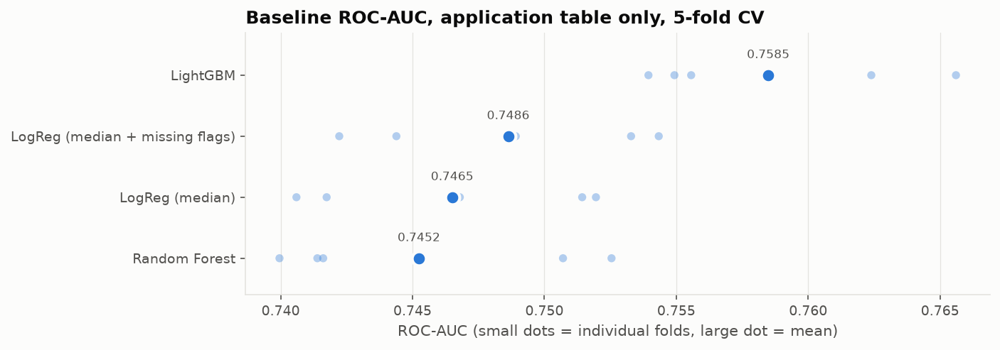

# Home Credit Default Risk: Why Models Disagree

> **TL;DR** *(to be written when results are in)*
> - I compared Logistic Regression, Random Forest and LightGBM on ~307k loan applications (~8% default rate).
> - **[Winner]** won because **[reason]**.
> - Business takeaway: **[threshold / approval-rate recommendation]**.

🚧 **Work in progress.**

## Problem
Home Credit lends to people with little or no credit history. The task is to predict whether an applicant will default (`TARGET = 1`), using the application form plus their previous loans, bureau records, card balances and installment payments (7 related tables).

The point of this project is not leaderboard rank. It's to understand **why different model families behave differently on the same data**, and what that means for a lending decision.

## Hypotheses (written before training)
| # | Question | Hypothesis |
|---|----------|------------|
| H1 | Non-linearity | LightGBM beats Logistic Regression, but binning/WoE features close most of the gap. |
| H2 | Missing data | Missingness itself carries signal; LightGBM's native handling beats mean/median imputation. |
| H3 | Calibration | Random Forest probabilities are squeezed toward the middle; Logistic Regression is well calibrated. |
| H4 | Class imbalance | With ~8% positives, PR-AUC separates models more clearly than ROC-AUC. |

## Results
*Same CV folds, same metric for every model.*

### Stage 1 · Baseline: application table only, no tuning
5-fold stratified CV on 307,511 applications ([notebook](notebooks/02_baseline.ipynb)). Lower is better for Brier and LogLoss.

| Model | ROC-AUC | PR-AUC | Brier | LogLoss |
|-------|--------:|-------:|------:|--------:|
| **LightGBM** | **0.7585** ± 0.005 | **0.2432** | **0.0679** | **0.2461** |
| Logistic Regression (median + missing flags) | 0.7486 ± 0.005 | 0.2274 | 0.0685 | 0.2491 |
| Logistic Regression (median) | 0.7465 ± 0.005 | 0.2227 | 0.0687 | 0.2499 |
| Random Forest | 0.7452 ± 0.006 | 0.2255 | 0.0693 | 0.2528 |
| *Constant 8.07% (no model)* | *0.5* | *0.081* | *0.0742* | *0.2805* |



### Stage 2 · With history tables *(to do)*

| Model | CV ROC-AUC | CV PR-AUC | Brier | Kaggle (private) |
|-------|-----------:|----------:|------:|-----------------:|
| Logistic Regression | | | | |
| Logistic Regression + WoE | | | | |
| Random Forest | | | | |
| LightGBM | | | | |

## Why the models differ
*(one section per hypothesis: did it hold, and why / why not)*

## Business layer: choosing a threshold
*(approval rate vs expected loss)*

## Repository structure
```
notebooks/        EDA and modelling (outputs kept so GitHub renders the plots)
src/              reusable feature engineering and training code
reports/figures/  figures used in this README
```

## Reproduce
```bash
# 1. Environment (uv)
uv sync
# or with pip
pip install -r requirements.txt

# 2. Data: accept the competition rules on Kaggle first, then
kaggle competitions download -c home-credit-default-risk -p data/raw
unzip data/raw/home-credit-default-risk.zip -d data/raw
```
macOS: LightGBM needs OpenMP (`brew install libomp`).

The competition data cannot be redistributed, so it is not included in this repo.
